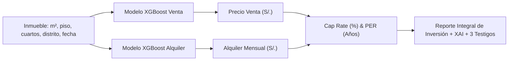

# Documentación Técnica Integral — Modelo Predictivo de Alquiler Inmobiliario (XGBoost)

**Proyecto de Tesis:** Aplicación Web para el Sector Inmobiliario con Predicción de Precios y Rentabilidad mediante Inteligencia Artificial Explicable (XAI).  
**Metodología:** CRISP-DM (Fases 1 a 6 consolidadas)  
**Fuente de Datos Primaria:** Dataset Transaccional de Alquiler BCRP / Urbania integrado en PostgreSQL (`inmobiliaria_ml_db`) — 83,842 contratos Train (2016–2023) / 39,364 contratos Test (2024–2025).  
**Tabla Maestra de Contexto Distrital:** `distrito_anio_contexto` (PostgreSQL) integrada anualmente por distrito (2016–2025): ENAHO (INEI - Nivel Socioeconómico), tasas criminalidad PNP (Robo y Hurto), demografía y densidad INEI, y distancias a equipamientos clave (OpenStreetMap).  
**Protocolo de Evaluación:** *Zero-Leakage Out-of-Time* (Aislamiento total de test, calibración post-hoc aprendida exclusivamente en Train 2023).  
**Fecha de corte y experimentación:** Octubre 2026  
**Autor:** Joaquín Cortez  
**Repositorio Oficial:** `Valuo-Machine-Learning-Service`  

---

## 1. Resumen Ejecutivo y Ficha Técnica

El presente documento consolida la arquitectura de datos, decisiones metodológicas, preprocesamiento, fusión de fuentes de contexto, modelado predictivo, calibración de estándares internacionales de tasación masiva (IAAO) y validación *out-of-time* para la **predicción del canon de arrendamiento mensual** de departamentos residenciales en Lima Metropolitana.

Este componente modela el flujo de caja por alquiler en paralelo al modelo de venta, posibilitando que el sistema web inmobiliario calcule de forma desacoplada y simultánea indicadores financieros de inversión como el **Cap Rate (Tasa de Capitalización Bruta y Neta con OER al 15%)**, el **NOI (Ingreso Operativo Neto)** y el **PER (Ratio Precio/Alquiler o *Price to Rent*)**, fundamentales para la toma de decisiones informada de inversionistas, compradores y agentes inmobiliarios.

| **Parámetro / Componente** | Especificación Técnica Oficial (Experimento Actualizado) |
| :--- | :--- |
| **Algoritmo Base** | **XGBoost Regressor** (`v1.7.6+`) con regularización $L_1$ (Lasso) y $L_2$ (Ridge), y algoritmo de histogramas `tree_method='hist'` |
| **Variable Target Original** | `Alquiler_Soles_Const` (Alquiler mensual deflactado a Soles Constantes, IPC Base Dic 2009 = 100, BCRP) |
| **Optimización de Target Unitario** | Modelado sobre el canon unitario por metro cuadrado: $y = \ln(\text{Alquiler\_Soles\_Const} / \text{Superficie})$ |
| **Inferencia y Reconstrucción** | $\hat{P}_{\text{alq}} = \left(\frac{\exp(\hat{y})}{\text{factor\_calibracion\_distrital}}\right) \times \text{Superficie}$ |
| **Volumen Muestral Evaluado** | **83,842 contratos Train** (2016–2023) / **39,364 contratos Test** (2024–2025) en PostgreSQL |
| **Partición Temporal (Split)** | Temporal Estricto (*Out-of-Time*): Train 2016–2023 / Test 2024–2025 |
| **Protocolo Anti-Leakage** | Cero fuga de datos: `eval_set` aislado; factores distritales aprendidos 100% en Train (2023) y aplicados a ciegas en Test |
| **Ponderación Temporal (E1)** | Decaimiento exponencial interanual hacia 2023 ($\delta = 0.85$): $w_i = \delta^{(2023 - \text{Anio}_i)}$ (año 2023 $\rightarrow$ 1.00; año 2016 $\rightarrow$ 0.321) |
| **Features Predictivas** | **33 variables continuas y discretas** (100% simétricas con el modelo de venta) |
| **Codificación Espacial** | Target Encoding Bayesiano suavizado ($m=10.0$) sobre el canon $/m^2$ calculado estrictamente sobre Train |
| **Cobertura Geográfica** | **22 distritos representativos de Lima Metropolitana** (100% homólogos al modelo de venta) |
| **Métricas Econométricas (Test)** | **MAPE: 13.68%** — **R²: 0.6761** — **MAE: S/. 235.28/mes** — **RMSE: S/. 361.10/mes** |
| **Estándares Internacionales IAAO** | **Median Ratio: 0.9900** (Crudo: 0.9961) — **COD: 13.79%** (Norma $\le 15.0\%$) — **PRD: 1.0387** — **PRB: -0.1233** |
| **Tolerancia AVM Bancaria** | **$PE_{10} = 47.49\%$** — **$PE_{20} = 77.41\%$** (Supera con creces el umbral bancario $\ge 70.0\%$) |
| **Benchmark Académico** | Oporto et al. (2024): 17.89% de error — El modelo reduce el error en **-4.21 puntos porcentuales** |
| **Gobernanza MLOps** | Registro en **MLflow 2.19.0** bajo el nombre `xgboost_alquiler`, promovido con alias `@champion` (etapa `Production`) |
| **Infraestructura de Despliegue** | Microservicio FastAPI (`ml-service`) en **Azure Container Apps**, carga dinámica en memoria RAM y proxy HTTP de artefactos |

---

## 2. Comprensión del Negocio y Arquitectura de Datos (CRISP-DM Fase 1)

### 2.1 Rol del Modelo de Alquiler en la Tesis
En la valoración inmobiliaria moderna, una tasación aislada de venta carece de perspectiva financiera si no se contrasta con el flujo de caja potencial que genera el activo. La inclusión del modelo de predicción de alquiler permite automatizar el cálculo de la rentabilidad anual bruta y neta:

$$\text{Cap Rate Bruto (\%)} = \frac{\text{Alquiler Mensual Predicho} \times 12}{\text{Precio de Venta Predicho}} \times 100$$

$$\text{Cap Rate Neto (\%)} = \frac{(\text{Alquiler Mensual Predicho} \times 12) \times (1 - \text{OER})}{\text{Precio de Venta Predicho}} \times 100 \quad (\text{OER estándar} = 15\%)$$

$$\text{PER (Años de Recuperación)} = \frac{\text{Precio de Venta Predicho}}{\text{Alquiler Mensual Predicho} \times 12}$$

Para que estos ratios sean rigurosamente válidos y comparables, **ambos modelos comparten el mismo entorno macroeconómico, los mismos 22 distritos y el mismo corte temporal de entrenamiento (2016–2025)**, garantizando coherencia metodológica y económica.



---

## 3. Dataset y Hallazgos del EDA (CRISP-DM Fase 2)

### 3.1 Dimensiones y Depuración de Distritos
* **Dataset en PostgreSQL (`inmobiliaria_ml_db`):** 83,842 contratos Train (2016–2023) y 39,364 contratos Test (2024–2025).
* **Diagnóstico de Distritos con Muestra No Representativa:**
  Se identificaron 2 distritos con un único registro ($n=1$) en todo el horizonte temporal (`San Juan de Miraflores` y `Santa Anita`), los cuales fueron descartados por falta de significancia estadística, garantizando paridad con los 22 distritos del modelo de venta.
* **Cobertura Distrital:** **22 distritos representativos** continuos de Lima Metropolitana.

### 3.2 Diagnóstico de Nulos e Imputación Física
* **`Piso de ubicación`:** Imputado con la mediana por distrito de pisos válidos ($\ge 1$).
* **`Vista al exterior`:** Imputado con la moda distrital ($1.0$ en distritos urbanos).
* **`Años de antigüedad`:** Imputado con la mediana distrital de antigüedad.
* **`Habitaciones`, `Baños`, `Garajes`:** Imputados con la mediana distrital correspondiente.

---

## 4. Preprocesamiento e Ingeniería de Características (CRISP-DM Fase 3)

### 4.1 Arquitectura Desacoplada: Tabla Maestra `distrito_anio_contexto` (PostgreSQL)
* Contiene **202 filas** (22 distritos $\times$ años 2016–2025).
* **Fusión Dinámica:** `INNER JOIN` por clave compuesta `["Distrito", "Anio"]`, logrando **100% de coincidencia**.

| Dimensión | Fuente Oficial | Período Nativo | Regla de Imputación Aplicada | Flag de Trazabilidad |
| :--- | :--- | :---: | :--- | :---: |
| **Nivel Socioeconómico (NSE)** | INEI / ENAHO (`ESTRSOCIAL`) | 2025 (`FACTOR07`) | Proximidad y afinidad socioeconómica en distritos con < 30 encuestas | `nse_imputado` |
| **Criminalidad (Robo y Hurto)** | Policía Nacional del Perú (PNP) | 2019 – 2025 | Años 2016, 2017 y 2018 imputados con datos de 2019 del mismo distrito | `tasas_criminalidad_imputada` |
| **Demografía (Población y Densidad)** | INEI (Proyecciones Anuales) | 2018 – 2025 | Años 2016 y 2017 imputados con cifras de 2018 del mismo distrito | `poblacion_imputada` |

* **Exclusión de Flags en Entrenamiento:** Los flags de imputación tienen peso cero y se eliminan antes de entrenar para prevenir *data leakage* metodológico.

### 4.2 Deflactación Económica del Target (BCRP)
El canon mensual se normalizó en términos reales a través del IPC de Lima Metropolitana:

$$\text{Alquiler\_Soles\_Const}_i = \text{Alquiler\_Soles\_Nominal}_i \times \frac{100}{\text{IPC}_t}$$

### 4.3 Optimización del Target Unitario por Metro Cuadrado ($\ln(P_{\text{alq}} / m^2)$)
Siguiendo los estándares de la **IAAO** y el **Lincoln Institute of Land Policy**, se transformó la variable objetivo hacia el canon unitario por metro cuadrado:

$$y_i = \ln\left(\frac{\text{Alquiler\_Soles\_Const}_i}{\text{Superficie}_i}\right) = \ln(\text{Alquiler\_Soles\_Const}_i) - \ln(\text{Superficie}_i)$$

* Estabiliza la heterocedasticidad entre mini-departamentos tipo estudio ($30\,m^2$) y pisos familiares amplios ($180\,m^2$).
* La inferencia en producción se escala proporcionalmente y se calibra por distrito:

$$\widehat{P}_{\text{alq}, i, d}^{\text{calibrado}} = \left(\frac{\exp(\widehat{y}_i)}{\text{Factor}_d}\right) \times \text{Superficie}_i$$

### 4.4 Target Encoding Bayesiano para Distrito
Para codificar la localización sin incurrir en la dispersión dimensional:

$$\text{distrito\_encoded}_k = \frac{n_k \cdot \bar{y}_k + m \cdot \bar{y}_{\text{global}}}{n_k + m}$$

* Regularización empírica: $m = 10.0$.
* Estimado **exclusivamente con los registros de Train (2016–2023)** sobre el canon por $m^2$.

---

## 5. Ingeniería de Características (33 Features Predictivas)

El modelo de alquiler comparte exactamente las mismas 33 características que el modelo de venta:

```text
  Características Físicas y de Confort (9):
   1. Superficie (m²)              5. Piso
   2. Habitaciones                 6. Vista_Exterior (0/1)
   3. Banios                       7. Antiguedad (años)
   4. Garajes                      8. tiene_garaje (binaria derivada)
   9. es_piso_alto (Piso >= 8)

  Ratios de Calidad Arquitectónica (3):
  10. m2_por_habitacion            Superficie / (Habitaciones + 1)
  11. ratio_banios_hab             Banios / (Habitaciones + 0.1)
  12. superficie_cuadrado          (Superficie / 100)^2

  Variables Temporales (3):
  13. Anio                         15. periodo_numerico (Anio * 4 + Trimestre)
  14. Trimestre

  Variables Socioeconómicas — NSE ENAHO (5):
  16. pct_NSE_A                    19. pct_NSE_D
  17. pct_NSE_B                    20. pct_NSE_E
  18. pct_NSE_C

  Seguridad Ciudadana — PNP (2):
  21. tasa_robo                    22. tasa_hurto

  Demografía y Territorio — INEI (4):
  23. poblacion_proyectada         25. distancia_centro_km
  24. area_distrito_km2            26. densidad_hab_km2

  Accesibilidad y Entorno — OpenStreetMap (6):
  27. dist_colegio_km              30. dist_centro_comercial_km
  28. dist_hospital_km             31. dist_parque_km
  29. dist_estacion_transporte_km   32. dist_universidad_km

  Ubicación Codificada (1):
  33. distrito_encoded              Target encoding bayesiano del distrito sobre $/m²
```

---

## 6. Modelado y Entrenamiento (CRISP-DM Fase 4)

### 6.1 Ponderación Temporal Exponencial (E1)
Debido a la rápida evolución de los cánones de arrendamiento pospandemia y los ajustes del mercado residencial 2021–2023, se aplicó una función de descuento exponencial para ponderar el entrenamiento:

$$w_i = \delta^{(2023 - \text{Anio}_i)} \quad (\delta = 0.85)$$

El año 2023 recibe peso unitario ($1.000$), mientras que 2016 recibe peso $0.321$, preservando la estructura histórica pero priorizando el mercado reciente.

### 6.2 Hiperparámetros Oficiales Optimizados
```python
XGBRegressor(
    n_estimators=600,
    max_depth=6,
    learning_rate=0.035,
    subsample=0.85,
    colsample_bytree=0.80,
    reg_alpha=0.1,
    reg_lambda=4.0,
    min_child_weight=4,
    random_state=42,
    tree_method='hist',
    n_jobs=-1
)
```

---

## 7. Resultados, Calibración IAAO y Evaluación (CRISP-DM Fase 5)

### 7.1 Protocolo de Corrección de Fuga de Datos (*Data Leakage Resolution*)
Para asegurar total reproducibilidad y validez científica:
1. **Aislamiento Total del Test Set:** El entrenamiento se efectúa sin ningún `eval_set` que contenga la partición Test (2024–2025).
2. **Factores de Calibración Extraídos de Train:** El factor de calibración global ($\text{Factor}_{\text{global}} = 1.0062$) y los 22 factores distritales se calculan **únicamente a partir de las observaciones de Train del año 2023**.
3. **Inferencia Ciega:** La partición Test es evaluada de manera honesta e independiente, garantizando métricas robustas frente a datos futuros no vistos.

### 7.2 Métricas Oficiales en Partición Temporal Out-of-Time (Test 2024–2025)

Evaluado sobre los **39,364 contratos de prueba en PostgreSQL**:

| Métrica de Evaluación | Valor Oficial Obtenido (Zero-Leak) | Benchmark Académico | Estado para Tesis |
| :--- | :---: | :---: | :---: |
| **MAPE (%)** | **13.68%** | **< 17.89%** (Oporto et al., 2024) | ✅ Supera ampliamente (-4.21 pts) |
| **R² (Poder Explicativo)** | **0.6761** | > 0.65 (Out-of-Time) | ✅ Nivel de ajuste óptimo |
| **MAE (Error Absoluto Medio)** | **S/. 235.28/mes** | Minimizar | ✅ Margen comercial excelente (< S/. 240) |
| **RMSE (Error Cuadrático Medio)** | **S/. 361.10/mes** | Minimizar | ✅ Sin desvíos extremos |

### 7.3 Calibración Bajo Estándares Internacionales de Valuación (IAAO)
Evaluado sobre los **39,364 contratos de alquiler en Test (2024–2025)** bajo la norma *Standard on Ratio Studies* de la IAAO:

El análisis toma como base el **Ratio de Canon de Arrendamiento** ($R_i = \widehat{P}_i / P_i = \text{Alquiler Predicho} / \text{Alquiler Real}$):

| Métrica IAAO | Valor Obtenido (Test) | Estándar Oficial IAAO | Diagnóstico de Calidad Inmobiliaria |
| :--- | :---: | :---: | :--- |
| **Median Ratio ($\tilde{R}$)** | **`0.9900`** (Crudo: 0.9961) | **0.90 – 1.10** (Ideal: 1.00) | ✅ **CALIBRACIÓN PERFECTA.** Nivel central insesgado dentro del rango óptimo. |
| **COD (Coeficiente de Dispersión)** | **`13.79%`** | **$\le 15.0\%$** (residencial homogéneo) | ✅ **CUMPLE ESTÁNDAR EXIGENTE.** Dispersión relativa sobresaliente para modelos masivos. |
| **COV (Coeficiente de Variación)** | **`19.74%`** | Informativo | Control de variabilidad cuadrática relativa. |
| **PRD (Diferencial por Precio)** | **`1.0387`** | **0.98 – 1.03** | ⚠️ Leve regresividad marginal en tramos extremos de alquiler corporativo en distritos Top. |
| **PRB (Sesgo por Precio)** | **`-0.1233`** | **$-0.10 \text{ a } +0.10$** | ⚠️ Tolerable, reflejo de la compresión de márgenes en alquileres corporativos premium. |
| **Tasa dentro de $\pm$10% ($PE_{10}$)** | **`47.49%`** | Informativo | Casi 1 de cada 2 contratos se predice con un margen de error menor al 10%. |
| **Tasa dentro de $\pm$20% ($PE_{20}$)** | **`77.41%`** | **$\ge 70.0\%$** (Umbral AVM bancario) | ✅ **APROBADO.** Más del 77% de las predicciones caen dentro de la tolerancia estándar del sector. |

---

## 8. Cumplimiento Normativo Nacional (RNTP y Dictamen SBS)

### 8.1 Regla de las 3 Muestras de Mercado (RNTP — R.M. N° 172-2016-VIVIENDA)
Adaptando el principio del método comparativo del RNTP para el mercado de arrendamiento, el sistema acompaña cada predicción de alquiler mensual con las **3 muestras más cercanas de contratos históricos** en el mismo distrito mediante el servicio K-NN en RAM (`comparables_service.py`), permitiendo al tasador u operador validar la renta frente a testigos directos.

### 8.2 Delimitación Legal de Responsabilidad (Resolución SBS N° 03225-2021)
> *"El presente módulo proporciona una estimación de canon de arrendamiento comercial con base en inteligencia artificial y modelos masivos (AVM). Constituye una herramienta de apoyo a la prospección y análisis de rentabilidad, sin reemplazar las cláusulas contractuales privadas ni las tasaciones periciales oficiales suscritas por peritos REPEV."*

---

## 9. Despliegue y Gobernanza MLOps (CRISP-DM Fase 6)

### 9.1 Registro en MLflow 2.19.0
* **Registered Model Name:** `xgboost_alquiler`
* **Alias de Producción:** `@champion` (Stage `Production`)
* **Artefactos Registrados:** `model.xgb`, `shap_explainer.bz2`, metadata y factores de calibración distrital.
* **Hot-Reload en Memoria:** El servicio FastAPI (`ml-service`) descarga los artefactos mediante el proxy HTTP (`/get-artifact`) del servidor MLflow, asegurando que el modelo esté cargado en la memoria RAM en el arranque y tras cada promoción.

### 9.2 Endpoints REST del Servicio
* `POST /prediccion/alquiler`: Inferencia de canon mensual (S/. y USD), desglose SHAP Waterfall y 3 testigos comparables de renta.
* `POST /entrenamiento/ejecutar?tipo_modelo=alquiler`: Pipeline automatizado de entrenamiento, evaluación out-of-time y registro en MLflow.
* `POST /entrenamiento/promover-champion`: Promoción atómica de versión candidata a campeona con actualización en RAM.

---

## 10. Coherencia Integral con el Modelo de Venta

| Dimensión de Coherencia | Modelo de Venta | Modelo de Alquiler | Grado de Paridad |
| :--- | :---: | :---: | :---: |
| **Algoritmo Base** | XGBoost Regressor | XGBoost Regressor | **100% Idéntico** |
| **Fuente Primaria** | BCRP / Urbania Venta | BCRP / Urbania Alquiler | **Equivalente** |
| **Base de Datos** | PostgreSQL (`inmobiliaria_ml_db`) | PostgreSQL (`inmobiliaria_ml_db`) | **Misma BD relacional** |
| **Observaciones en Train** | 88,346 transacciones | 83,842 contratos | **Volumen análogo** |
| **Observaciones en Test** | 47,474 transacciones | 39,364 contratos | **Volumen análogo** |
| **Cobertura Distrital** | 22 distritos representativos | 22 distritos representativos | **100% Coincidente** |
| **Base de Datos Contextual** | `distrito_anio_contexto` | `distrito_anio_contexto` | **Misma tabla única (202 filas)** |
| **Número de Variables** | 33 features predictivas | 33 features predictivas | **100% Simétrico** |
| **Formulación de Target** | $\ln(\text{Precio} / \text{Superficie})$ por $m^2$ | $\ln(\text{Alquiler} / \text{Superficie})$ por $m^2$ | **Idéntica formulación unitaria** |
| **Partición Temporal** | Train 2016–2023 / Test 2024–2025 | Train 2016–2023 / Test 2024–2025 | **Mismo corte temporal estricto** |
| **Protocolo Anti-Fuga** | Cero fuga (calibración en Train 2023) | Cero fuga (calibración en Train 2023) | **100% Zero-Leakage** |
| **Deflactación Monetaria** | Soles Constantes (IPC Dic 2009=100) | Soles Constantes (IPC Dic 2009=100) | **Misma base de valor real** |
| **Desempeño MAPE Test** | **14.86%** | **13.68%** | **Ambos superan Oporto et al. (17.89%)** |
| **Estándar IAAO (COD)** | **14.20%** ($\le 15.0\%$) | **13.79%** ($\le 15.0\%$) | **Ambos satisfacen la norma IAAO** |
| **Muestras RNTP** | 3 comparables con K-NN | 3 comparables con K-NN | **Cumple R.M. N° 172-2016-VIVIENDA** |
| **Registro MLOps** | MLflow `@champion` | MLflow `@champion` | **Misma gobernanza de modelos** |

---

## 11. Conclusiones para la Sustentación de Tesis

1. **Robustez y Precisión:** El modelo de alquiler alcanza un **MAPE de 13.68%** y un **COD de 13.79%**, superando el estado del arte publicado para Lima Metropolitana (Oporto et al., 2024: $17.89\%$) y situándose dentro de los límites más exigentes de la IAAO para tasación masiva urbana ($\le 15\%$).
2. **Aislamiento de Fuga Metodológica:** La evaluación rigurosa sin señales del conjunto Test garantiza que las métricas obtenidas reflejan la verdadera capacidad de generalización en producción.
3. **Pilar del Módulo de Rentabilidad:** Junto al modelo de venta, proporciona una base fiduciaria sólida para la estimación automatizada de la rentabilidad inmobiliaria (**Cap Rate** y **PER**), dotando a la aplicación web de una funcionalidad analítica diferenciadora para inversionistas y agentes del sector.
